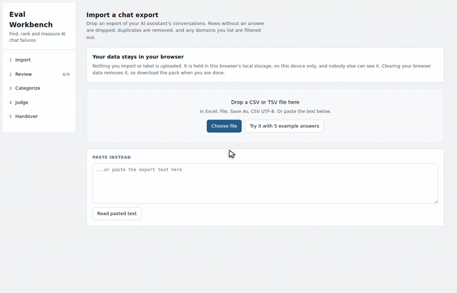

# Chat Eval Workbench

A single-page tool for finding, ranking and measuring failures in AI chat products.

Most teams evaluate conversational AI with a rubric full of words like *helpful*, *clear* and *actionable*. That measures how an answer sounds. It does not measure whether the answer did its job. A confident, well formatted reply with a wrong total scores higher than a plain correct one.

This tool runs the other process: a person reads real conversations, labels what went wrong, the failures get grouped and counted, and only the most frequent one gets an automated check built for it.



**Live version (with the Claude-powered steps):** https://claude.ai/artifact/UBghVF4G8oD64QVVSQv3oZ

## The five steps

| Step | What happens |
| --- | --- |
| 1. Import | Drop in a CSV or TSV export of your assistant's conversations. Rows without an answer are dropped, duplicates removed, internal and vendor domains filtered out, and a random sample taken. |
| 2. Review | One question and answer at a time, with a free text note and a binary verdict: fine, or something is wrong. Categories stay hidden here on purpose, so sorting does not bias what you notice. |
| 3. Categorize | Your notes become 4 to 6 failure categories. The tool counts how many traces fall in each, which is what sets the priority. |
| 4. Judge | Write or draft an LLM-as-judge prompt for the top failure, run it across the traces you labelled, and see a confusion matrix: how many of your failures it catches, how many good answers it wrongly flags, and every disagreement. |
| 5. Handover | A text pack with the failures, counts, examples and the validated judge prompt, plus a CSV of every labelled trace, ready for an engineering ticket. |

## Why it is built this way

**Binary labels, not 1 to 5 scores.** The difference between a 3 and a 4 is not stable across sessions or people, and it hides uncertainty in the middle of the scale.

**Categories come after reading, not before.** A rubric written up front makes reviewers check boxes instead of noticing what they did not expect.

**Frequency decides the order of work.** Every failure feels urgent when you meet it alone. Counting is what turns a pile of complaints into a priority.

**The judge is validated against human labels.** A judge nobody checked is a number nobody should trust. The tool shows the true positive and true negative rate against your own labels, and lists every disagreement so you can tell whether the prompt is wrong or your label was.

**Code before LLM judges.** Where a correct answer exists in your systems, a deterministic check against it is cheaper, faster and exact. The judge is for the failures with no stored truth: a lost conversation thread, an assumption presented as a measurement, an answer that quietly changed the question.

## Running it

It is one self-contained HTML file with no build step and no dependencies.

```bash
git clone https://github.com/<your-username>/chat-eval-workbench.git
cd chat-eval-workbench
python3 -m http.server 8000
# then open http://localhost:8000
```

Or open `index.html` directly in a browser.

## Privacy

Everything stays in the browser. Imported conversations, notes, categories and judge prompts are held in `localStorage` on the viewer's own device. Nothing is uploaded and there is no backend. Clearing browser data clears the work, so export the pack before you finish.

## What this version cannot do

Drafting a judge prompt with AI and running the judge across traces both need a model. Those two steps work in the [hosted version](https://claude.ai/artifact/UBghVF4G8oD64QVVSQv3oZ), which calls Claude with the viewer's own account. Everything else, including writing a judge prompt by hand and the whole review and prioritisation flow, works in this copy.

## Credit

The method comes from the AI evals work of Hamel Husain and Shreya Shankar, and from [this episode of Lenny's Podcast](https://www.youtube.com/watch?v=BsWxPI9UM4c&t=4201s). The tool is my own.

## Licence

MIT
